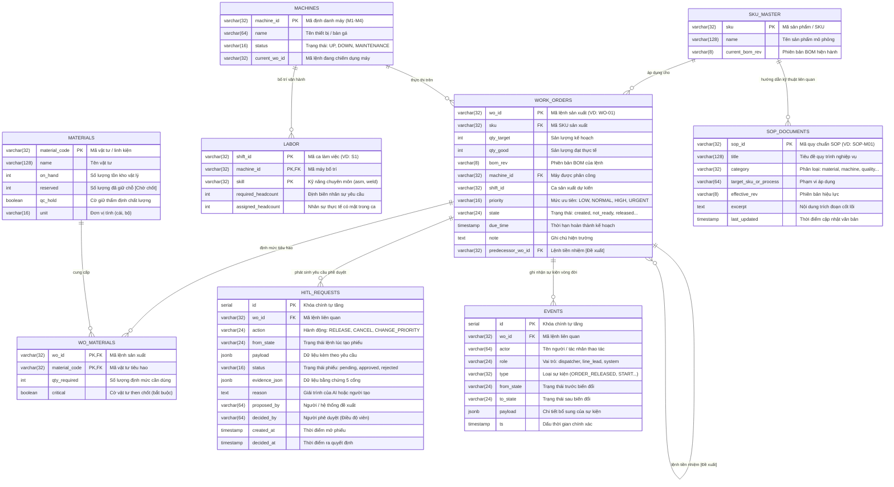
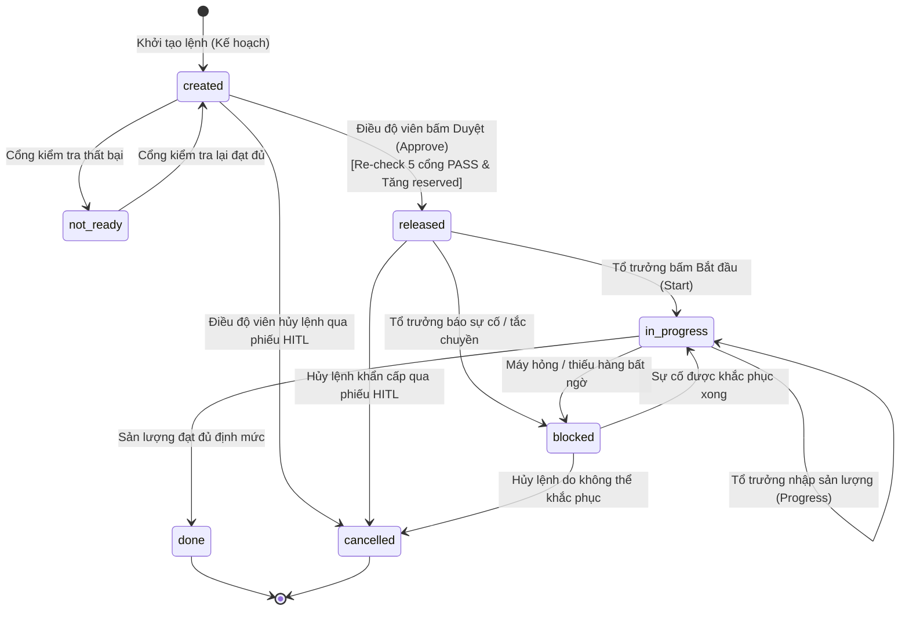

# Đặc Tả Mô Hình Thực Thể Quan Hệ (ERD Specification) — MES Mô Phỏng MFG-08 SmartWO

Tài liệu này đặc tả chi tiết cấu trúc dữ liệu của hệ thống điều hành sản xuất mô phỏng (Simulated MES) phục vụ bài toán **MFG-08 SmartWO**. Mô hình được kế thừa và phát triển từ tài liệu thiết kế nền tảng `research/mfg-08/06-thiet-ke-he-thong.md`, đồng thời mở rộng để đáp ứng trọn vẹn **5 cổng kiểm tra độ sẵn sàng (Readiness Gates)**, quan hệ phụ thuộc công đoạn tiền nhiệm (**Predecessor Work Order — Đề xuất mở rộng**), công cụ tra cứu quy trình nghiệp vụ (**SOP Lookup Tool**) và nhật ký kiểm toán hành vi (**Audit Trail**).

---

## 1. Sơ Đồ Thực Thể Quan Hệ (Mermaid ERD)

---

## 2. Đặc Tả Chi Tiết Từng Thực Thể (Entity Details)

### 2.1. Bảng `sku_master` (Danh mục sản phẩm mẫu)
Lưu trữ thông tin danh mục mã thành phẩm sản xuất trên chuyền cụm cửa xe.
- `sku` (VARCHAR(32), Primary Key): Mã sản phẩm duy nhất (ví dụ: `P-100` cho Cửa trước bên lái, `P-200` cho Cửa trước bên phụ).
- `name` (VARCHAR(128), Not Null): Tên mô tả sản phẩm.
- `current_bom_rev` (VARCHAR(8), Not Null): Phiên bản bản vẽ định mức kỹ thuật hiện hành có hiệu lực (ví dụ: `B`). Dùng để đối chiếu tại **Cổng 4 (BOM Revision Match)**.

### 2.2. Bảng `materials` (Tồn kho vật tư & Trạng thái chất lượng)
Lưu trữ tình trạng tồn kho vật lý, số lượng đã cam kết cấp phát và trạng thái kiểm soát chất lượng.
- `material_code` (VARCHAR(32), Primary Key): Mã định danh vật tư (ví dụ: `BLT-1`, `HSG-1`, `QC-9`).
- `name` (VARCHAR(128), Not Null): Tên chi tiết linh kiện.
- `on_hand` (INT, Not Null, Check: `>= 0`): Số lượng tồn kho vật lý đang có trong kho.
- `reserved` (INT, Not Null, Default: 0, Check: `>= 0`): Số lượng đã được giữ chỗ/cấp phát cho các lệnh đã phát hành (`released`).
  > **Ghi chú nghiệp vụ:** Cơ chế tăng `reserved` ngay lúc Duyệt thành công là **`[Quyết định nhóm đang chờ chốt]`** (khớp US-05 AC-02 / EV-25; research 01 từng liệt kê "không giữ chỗ kho"). Hệ thống prototype triển khai trong store logic và gắn nhãn ghi chú rõ ràng.
- `qc_hold` (BOOLEAN, Not Null, Default: FALSE): Cờ đánh dấu lô hàng đang bị cách ly chờ kiểm tra chất lượng. Nếu `TRUE`, vật tư **tuyệt đối không được tính vào tồn khả dụng** phục vụ cấp phát.
- `unit` (VARCHAR(16), Not Null): Đơn vị tính (cái, bộ, thanh).

> **Công thức Cổng 1:** Tồn khả dụng = `on_hand - reserved`. Điều kiện đạt: `(on_hand - reserved) >= qty_required` VÀ `qc_hold === FALSE`.

### 2.3. Bảng `machines` (Trạng thái thiết bị & Phân bổ máy không xung đột)
Quản lý năng lực và tính sẵn sàng của các máy móc/trạm lắp ráp trên chuyền. Nhằm đảm bảo kiểm thử UAT US-02 AC-05 / EV-29 (luật máy bị chiếm) không bị xung đột, seed được mở rộng lên 4 máy:
- `machine_id` (VARCHAR(32), Primary Key): Mã thiết bị (ví dụ: `M1`, `M2`, `M3`, `M4`).
- `name` (VARCHAR(64), Not Null): Tên thiết bị:
  - `M1`: Bàn gá chính C1 (Trạng thái `UP`, đang rảnh phục vụ WO-01).
  - `M2`: Máy hàn bấm viền (Trạng thái `DOWN`, phục vụ WO-04 fail Cổng 2).
  - `M3`: Máy siết bu-lông tự động (Trạng thái `MAINTENANCE`, phục vụ WO-05 fail Cổng 2).
  - `M4`: Bàn gá phụ C2 (Trạng thái `UP`, đang bị chiếm bởi WO-11 `in_progress`).
- `status` (VARCHAR(16), Not Null, Check: `IN ('UP', 'DOWN', 'MAINTENANCE')`): Tình trạng máy.
- `current_wo_id` (VARCHAR(32), Nullable): Mã lệnh sản xuất đang chiếm dụng thiết bị này tại thời điểm hiện tại.

> **Quy tắc Cổng 2:** Máy phải có `status === 'UP'` VÀ (máy đang rảnh `current_wo_id === null` HOẶC `current_wo_id === wo.wo_id`).

### 2.4. Bảng `labor` (Định biên nhân sự theo ca)
Kiểm soát sự sẵn sàng của nguồn nhân lực trực tiếp đứng chuyền theo từng ca làm việc và kỹ năng chuyên môn.
- `shift_id` (VARCHAR(32), Composite Primary Key): Mã ca làm việc (ví dụ: `S1` - Ca sáng).
- `machine_id` (VARCHAR(32), Composite Primary Key, Foreign Key -> `machines.machine_id`): Máy/trạm được bố trí.
- `skill` (VARCHAR(32), Composite Primary Key): Kỹ năng chuyên môn yêu cầu (ví dụ: `asm` - lắp ráp cơ khí, `weld` - kỹ thuật hàn).
- `required_headcount` (INT, Not Null, Check: `> 0`): Định biên nhân sự tối thiểu cần thiết.
- `assigned_headcount` (INT, Not Null, Default: 0, Check: `>= 0`): Số lượng công nhân đạt chuẩn kỹ năng thực tế có mặt.

> **Quy tắc Cổng 3:** `assigned_headcount >= required_headcount`.

### 2.5. Bảng `work_orders` (Lệnh sản xuất)
Trọng tâm quản lý vòng đời lệnh sản xuất trên chuyền.
- `wo_id` (VARCHAR(32), Primary Key): Mã lệnh sản xuất duy nhất (ví dụ: `WO-01`, `WO-02`).
- `sku` (VARCHAR(32), Not Null, Foreign Key -> `sku_master.sku`): Mã sản phẩm cần làm.
- `qty_target` (INT, Not Null, Check: `> 0`): Sản lượng kế hoạch cần đạt.
- `qty_good` (INT, Not Null, Default: 0, Check: `>= 0`): Sản lượng sản phẩm đạt tiêu chuẩn đã sản xuất thực tế.
- `bom_rev` (VARCHAR(8), Not Null): Phiên bản bản vẽ BOM được gán khi tạo lệnh.
- `machine_id` (VARCHAR(32), Not Null, Foreign Key -> `machines.machine_id`): Trạm máy được gán gia công.
- `shift_id` (VARCHAR(32), Not Null): Ca sản xuất dự kiến thực hiện.
- `priority` (VARCHAR(16), Not Null, Check: `IN ('LOW', 'NORMAL', 'HIGH', 'URGENT')`): Mức độ ưu tiên điều độ.
- `state` (VARCHAR(24), Not Null, Check: `IN ('created', 'not_ready', 'released', 'in_progress', 'blocked', 'done', 'cancelled')`): Trạng thái vật lý của lệnh trong DB.
- `due_time` (TIMESTAMP, Not Null): Hạn giao nộp sản phẩm hoàn thành. Dùng để tính toán cảnh báo trễ hạn (`late`).
- `note` (TEXT, Nullable): Ghi chú hiện trường.
- `predecessor_wo_id` (VARCHAR(32), Nullable, Foreign Key -> `work_orders.wo_id`):
  > **Ghi chú quan trọng:** Cột này là **`[Đề xuất – nhóm chưa chốt]`** (do schema `06` gốc chưa có predecessor). Phục vụ kiểm tra Cổng 5. Nếu có giá trị, lệnh tiền nhiệm bắt buộc phải có `state === 'done'`.

### 2.6. Bảng `wo_materials` (Định mức vật tư tiêu hao cho lệnh)
Quan hệ nhiều - nhiều giữa lệnh sản xuất và danh mục vật tư cần cấp phát.
- `wo_id` (VARCHAR(32), Composite Primary Key, Foreign Key -> `work_orders.wo_id`): Mã lệnh.
- `material_code` (VARCHAR(32), Composite Primary Key, Foreign Key -> `materials.material_code`): Mã vật tư.
- `qty_required` (INT, Not Null, Check: `> 0`): Định mức số lượng cần cho lệnh này.
- `critical` (BOOLEAN, Not Null, Default: TRUE): Đánh dấu linh kiện then chốt, bắt buộc phải đủ 100% mới qua Cổng 1.

### 2.7. Bảng `hitl_requests` (Phiếu yêu cầu phê duyệt con người — HITL)
Lưu trữ các phiếu đề xuất hành động do AI Personal Agent hoặc hệ thống tạo ra, chờ Điều độ viên đưa ra quyết định cuối cùng.
- `id` (SERIAL / String, Primary Key): Mã định danh phiếu.
- `wo_id` (VARCHAR(32), Not Null, Foreign Key -> `work_orders.wo_id`): Mã lệnh liên quan.
- `action` (VARCHAR(24), Not Null, Check: `IN ('RELEASE', 'CANCEL', 'CHANGE_PRIORITY')`): Hành động được đề xuất.
- `from_state` (VARCHAR(24), Not Null): Trạng thái của lệnh tại thời điểm đề xuất mở phiếu.
- `payload` (JSONB, Not Null, Default: '{}'): Dữ liệu bổ trợ.
- `status` (VARCHAR(16), Not Null, Check: `IN ('pending', 'approved', 'rejected')`): Trạng thái phê duyệt của phiếu.
- `evidence_json` (JSONB, Nullable): Snapshot kết quả 5 cổng tại thời điểm đề xuất.
- `reason` (TEXT, Nullable): Giải trình logic của đề xuất bằng văn bản tiếng Việt.
- `proposed_by` (VARCHAR(64), Not Null, Default: 'ai_agent'): Nguồn tạo phiếu.
- `decided_by` (VARCHAR(64), Nullable): Tên điều độ viên ký duyệt hoặc từ chối.
- `created_at` (TIMESTAMP, Not Null, Default: CURRENT_TIMESTAMP): Thời điểm khởi tạo phiếu.
- `decided_at` (TIMESTAMP, Nullable): Thời điểm ra quyết định.

### 2.8. Bảng `events` (Nhật ký sự kiện kiểm toán — Audit Trail)
Ghi nhận toàn bộ vết lịch sử thay đổi trạng thái và tác động của người dùng lên hệ thống (khớp US-09).
- `id` (SERIAL / String, Primary Key): Mã sự kiện duy nhất.
- `wo_id` (VARCHAR(32), Not Null, Foreign Key -> `work_orders.wo_id`): Mã lệnh chịu tác động.
- `actor` (VARCHAR(64), Not Null): Danh tính người thực hiện.
- `role` (VARCHAR(24), Not Null): Vai trò tương tác (`dispatcher`, `line_lead`, `system`, `ai_agent`).
- `type` (VARCHAR(32), Not Null): Hành động (`ORDER_RELEASED`, `ORDER_STARTED`, `PROGRESS_REPORTED`, `ORDER_BLOCKED`, `STALE_APPROVE_BLOCKED`...).
- `from_state` (VARCHAR(24), Nullable): Trạng thái trước khi biến đổi.
- `to_state` (VARCHAR(24), Nullable): Trạng thái mới sau khi biến đổi.
- `payload` (JSONB, Nullable): Dữ liệu chi tiết sự kiện.
- `ts` (TIMESTAMP, Not Null, Default: CURRENT_TIMESTAMP): Dấu thời gian chính xác của sự kiện.

### 2.9. Bảng `sop_documents` (Kho tài liệu quy chuẩn vận hành tiêu chuẩn)
Cung cấp dữ liệu nghiệp vụ mỏng cho công cụ tra cứu của Personal Agent (khớp US-03).
- `sop_id` (VARCHAR(32), Primary Key): Mã tài liệu quy chuẩn (ví dụ: `SOP-M01`, `SOP-Q03`).
- `title` (VARCHAR(128), Not Null): Tiêu đề hướng dẫn vận hành.
- `category` (VARCHAR(32), Not Null): Phân nhóm quy trình.
- `target_sku_or_process` (VARCHAR(64), Not Null): Phạm vi áp dụng kỹ thuật.
- `effective_rev` (VARCHAR(8), Not Null): Phiên bản quy chuẩn có hiệu lực.
- `excerpt` (TEXT, Not Null): Trích đoạn điều khoản chế tài để giải thích trực quan cho người dùng.
- `last_updated` (TIMESTAMP, Not Null): Thời điểm sửa đổi tài liệu lần cuối.

---

## 3. Máy Trạng Thái Lệnh (State Machine) & Vòng Đời Phiếu HITL

Hệ thống phân định nghiêm ngặt giữa **Vòng đời trạng thái vật lý của Lệnh sản xuất (`work_orders.state`)** và **Vòng đời xử lý phiếu phê duyệt (`hitl_requests.status`)**:

### Quy Tắc Chuyển Đổi Trạng Thái & Tương Tác Phiếu (US-01, US-04, US-05, US-07):
1. **Lệnh ở trạng thái `created`:**
   - Trạng thái này không bao giờ tự nhảy thành `pending_confirm` trong cơ sở dữ liệu.
   - Khi AI Personal Agent tạo đề xuất phát lệnh, một dòng mới được chèn vào bảng `hitl_requests` với `status = 'pending'`.
   - **Giao diện Kanban hiển thị lệnh `created` có phiếu `pending` tại cột "Chưa phát" kèm Huy hiệu (Badge) `[Chờ duyệt]`** (khớp US-01 AC-02 / EV-33).
2. **Khi Điều độ viên bấm Duyệt (Approve — US-05):**
   - Chạy lại toàn bộ 5 cổng kiểm tra độ sẵn sàng.
   - Nếu vẫn đạt 5 cổng (`overall_ready === true`):
     - `work_orders.state` chuyển sang `released`.
     - `materials.reserved` tăng tương ứng với số lượng yêu cầu của lệnh (`qty_required`).
     - `hitl_requests.status` đổi thành `approved`.
     - Ghi nhận event `ORDER_RELEASED`.
   - Nếu có ít nhất 1 cổng bị trượt (`overall_ready === false` do dữ liệu bị thay đổi giữa chừng — US-06 / EV-18):
     - `work_orders.state` được giữ nguyên (`created`).
     - Tồn kho `materials.reserved` **giữ nguyên, không tăng**.
     - Báo lỗi từ chối duyệt ngay lập tức.
     - Ghi nhận event `STALE_APPROVE_BLOCKED`.
3. **Khi Điều độ viên bấm Từ chối (Reject — US-07):**
   - `hitl_requests.status` đổi thành `rejected`.
   - Lệnh vẫn giữ nguyên trạng thái ban đầu của nó (ví dụ reject phiếu CANCEL của WO-12 thì lệnh vẫn ở `released`, không bị tụt trạng thái — khớp EV-19).

---

## 4. Đối Chiếu: Cơ Sở Dữ Liệu Thật (PostgreSQL) vs Dữ Liệu Mock Trên Prototype

| Tiêu chí | Cơ sở dữ liệu thật (PostgreSQL Backend) | Mock Data Store trên Prototype (Frontend-Only) |
|---|---|---|
| **Lưu trữ** | Hệ quản trị CSDL PostgreSQL vật lý trên VPS Production. | Bộ nhớ trình duyệt (In-Memory Zustand Store). |
| **Kiểu dữ liệu** | SQL DDL (`VARCHAR`, `INT`, `BOOLEAN`, `TIMESTAMP`, `JSONB`). | TypeScript Interfaces (`string`, `number`, `boolean`, `Date`). |
| **Tính toàn vẹn** | Foreign Keys (`REFERENCES`), Check Constraints, Unique Keys. | Kiểm tra tính hợp lệ bằng code TypeScript trong các hàm Actions. |
| **Độ trễ** | Network I/O qua HTTP REST API (FastAPI) ~100–300ms. | Phản hồi tức thì trong 1ms (Zero Network Overhead). |
| **Khởi tạo dữ liệu** | Script SQL `seed.sql` chạy bằng migrate tool. | File hằng số TypeScript `src/data/mockData.ts`. |
| **Khôi phục trạng thái** | Endpoint `POST /demo/reset`. | Nút bấm `Reset Demo` trên Header kích hoạt action `resetSeed`. |
| **Mục đích sử dụng** | Phục vụ giai đoạn triển khai hoàn chỉnh (Sprint sau / Production). | Phục vụ wireframe tương tác cao, nghiệm thu logic và UAT trực quan ngay lập tức. |
